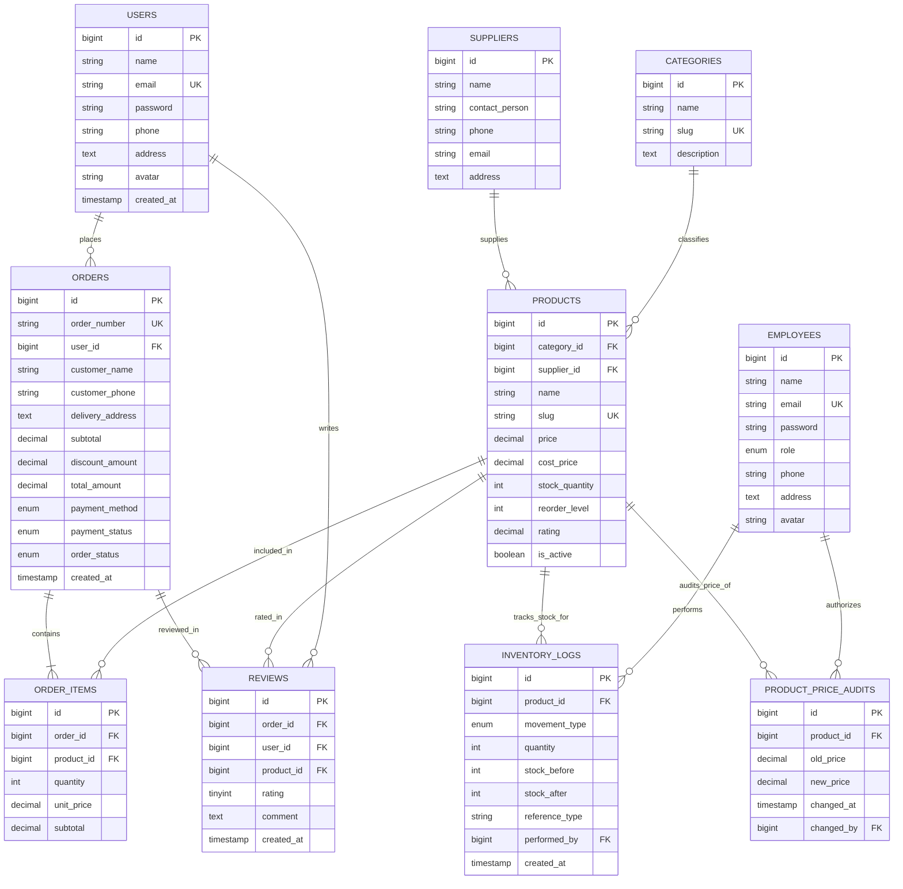

# DATABASE DESIGN & ENTITY-RELATIONSHIP MODEL
## Database Systems 1 — Milestone 2

**System:** Pastil Rice Davao: Inventory and Sales Management System  
**Database Engine:** MySQL 8.0 (InnoDB Storage Engine)  

---

### 1. Business Rules
1. **Customer and Employee Accounts:** The `users` table contains customers only. The `employees` table holds admin and cashier/staff login records, with a role of `admin` or `staff`. Both authenticate using Laravel Sanctum.
2. **Product Categorization:** Every product must belong to exactly one category (e.g., Beef, Chicken, Seafood, Combo, Sides & Drinks). A category cannot be deleted if active products reference it (`ON DELETE RESTRICT`).
3. **Suppliers & Sourcing:** A product may be sourced from an authorized supplier or prepared in-house. If a supplier record is removed, the product's `supplier_id` is set to `NULL` (`ON DELETE SET NULL`) rather than deleting the product.
4. **Non-Negative Constraints:**
   - Product `price` must be greater than or equal to 0.00 (`chk_product_price`).
   - Product `cost_price` must be greater than or equal to 0.00 (`chk_product_cost`).
   - Product `stock_quantity` must never drop below 0 (`chk_product_stock` and `trg_prevent_negative_stock`).
   - Order `total_amount` must be greater than or equal to 0.00 (`chk_order_total`).
   - Order item `quantity` must be strictly positive (`chk_item_quantity`).
5. **Transactional Inventory Tracking:** Every purchase of an order item automatically reduces the associated product's inventory count and writes an immutable audit record to `inventory_logs`.
6. **Price Modification Auditing:** Any alteration of a product's unit price triggers an automatic write into `product_price_audits` capturing the old price, new price, and timestamp.
7. **Order & Payment Lifecycle:** An order starts as `pending` or `preparing`. Once cooked and packed, staff dispatch it as `out_for_delivery`, and upon customer handover, mark it as `delivered`. If cancelled, inventory cannot remain deducted.
8. **Customer Feedback:** Customers can submit reviews (with ratings constrained between 1 and 5) linked to their completed orders.

---

### 2. Entity-Relationship Diagram (ERD)



---

### 3. Relational Schema
```text
USERS (
    id [PK], name, email [UQ], password, phone, address, avatar, created_at, updated_at
)

EMPLOYEES (
    id [PK], name, email [UQ], password, role [admin/staff], phone, address,
    avatar, created_at, updated_at
)

CATEGORIES (
    id [PK], name, slug [UQ], description, created_at, updated_at
)

SUPPLIERS (
    id [PK], name, contact_person, phone, email, address, created_at, updated_at
)

PRODUCTS (
    id [PK], category_id [FK -> CATEGORIES.id], supplier_id [FK -> SUPPLIERS.id],
    name, slug [UQ], description, price, cost_price, stock_quantity, reorder_level,
    rating, image_url, is_active, created_at, updated_at
)

ORDERS (
    id [PK], order_number [UQ], user_id [FK -> USERS.id], customer_name, customer_phone,
    delivery_address, delivery_landmark, delivery_instructions, subtotal, discount_amount,
    service_fee, total_amount, payment_method, payment_status, order_status,
    created_at, updated_at
)

ORDER_ITEMS (
    id [PK], order_id [FK -> ORDERS.id ON DELETE CASCADE],
    product_id [FK -> PRODUCTS.id ON DELETE RESTRICT],
    quantity, unit_price, subtotal, created_at, updated_at
)

INVENTORY_LOGS (
    id [PK], product_id [FK -> PRODUCTS.id ON DELETE CASCADE], movement_type,
    quantity, stock_before, stock_after, reference_type, reference_id,
    notes, performed_by [FK -> EMPLOYEES.id], created_at
)

REVIEWS (
    id [PK], order_id [FK -> ORDERS.id], user_id [FK -> USERS.id],
    product_id [FK -> PRODUCTS.id], rating, comment, created_at, updated_at
)

PRODUCT_PRICE_AUDITS (
    id [PK], product_id [FK -> PRODUCTS.id], old_price, new_price,
    changed_at, changed_by [FK -> EMPLOYEES.id]
)
```

---

### 4. Normalization Analysis (UNF to 3NF)

#### A. Unnormalized Form (UNF)
An unnormalized food sales log originally combined order headers, customer attributes, multi-valued repeating product rows, and category/supplier strings into a single spreadsheet:
`OrderSheet(OrderNo, CustomerName, CustomerEmail, CustomerPhone, Address, ItemNames, ItemQuantities, ItemPrices, CategoryName, SupplierName, SupplierPhone, OrderDate, Total)`
*Anomalies:* Repeating groups in items, extreme redundancy across orders, and update anomalies whenever supplier contact or product prices shift.

#### B. First Normal Form (1NF)
- **Rule:** Every column must contain only atomic (indivisible) values, and each record must have a unique Primary Key.
- **Action:** Repeating item lists were split into individual rows. Composite keys or surrogate keys were assigned.
- *Status:* Achieved. No repeating groups or comma-separated lists exist in any table.

#### C. Second Normal Form (2NF)
- **Rule:** Must be in 1NF and have NO Partial Dependencies (all non-key attributes must be fully functionally dependent on the entire primary key).
- **Action:** In order item records with a composite logical key `(order_id, product_id)`, product descriptions, category information, and supplier details depended only on `product_id`, not `order_id`. These were extracted into dedicated `PRODUCTS`, `CATEGORIES`, and `SUPPLIERS` tables.
- *Status:* Achieved. `ORDER_ITEMS` only stores line-item specific data (`quantity`, `unit_price`, `subtotal`).

#### D. Third Normal Form (3NF)
- **Rule:** Must be in 2NF and have NO Transitive Dependencies ($X \rightarrow Y$ and $Y \rightarrow Z$ where non-key attribute $Z$ depends on non-key attribute $Y$).
- **Action:**
  - In `PRODUCTS`, `category_name` and `category_description` depended on `category_id`, which depended on `product_id`. `CATEGORIES` was decoupled into its own relation.
  - In `PRODUCTS`, `supplier_contact` and `supplier_phone` depended on `supplier_id`. `SUPPLIERS` was decoupled into its own relation.
  - In `ORDERS`, `customer_email`, `customer_role`, and customer default credentials depended on `user_id`. `USERS` was decoupled into its own relation.
- *Status:* Achieved. Every non-prime attribute in all tables depends strictly on the key, the whole key, and nothing but the key.

#### E. Benefits of Normalization & Anomaly Prevention
1. **Insertion Anomaly Prevented:** We can register a new raw material supplier or create a new pastil category (e.g. "Desserts") without needing to create a dummy product or order first.
2. **Deletion Anomaly Prevented:** If an order is deleted or cancelled, we do not lose customer profiles, category descriptions, or historical product pricing.
3. **Update Anomaly Prevented:** If a supplier changes their contact phone or a category changes its name, we update exactly one row in `suppliers` or `categories`, rather than thousands of order item records.

---

### 5. Data Dictionary

#### Table 1: `users`
| Column Name | Data Type | Nullable | Key | Default | Description & Constraints |
| :--- | :--- | :--- | :--- | :--- | :--- |
| `id` | BIGINT UNSIGNED | NO | PK | Auto | Unique identifier for user |
| `name` | VARCHAR(150) | NO | | None | Full legal or display name |
| `email` | VARCHAR(150) | NO | UK | None | Unique login email address |
| `email_verified_at` | TIMESTAMP | YES | | NULL | Verification timestamp |
| `password` | VARCHAR(255) | NO | | None | Bcrypt password hash |
| `phone` | VARCHAR(30) | YES | | NULL | Contact mobile number |
| `address` | TEXT | YES | | NULL | Default delivery address |
| `avatar` | VARCHAR(30) | NO | | 'user' | Chosen account icon |
| `remember_token` | VARCHAR(100) | YES | | NULL | Sanctum / session remember token |
| `created_at` | TIMESTAMP | YES | | CURRENT | Account creation timestamp |
| `updated_at` | TIMESTAMP | YES | | CURRENT | Last update timestamp |

#### Additional account table: `employees`
| Column | Type | Meaning |
| :--- | :--- | :--- |
| `id` | BIGINT UNSIGNED PRIMARY KEY | Employee ID, independent of customer IDs |
| `name` | VARCHAR(255) | Employee display name |
| `email` | VARCHAR(255) UNIQUE | Employee login |
| `password` | VARCHAR(255) | Hashed password |
| `role` | ENUM('admin','staff') | Employee authorization role |
| `phone` / `address` | VARCHAR(30) / TEXT | Contact details |
| `avatar` | VARCHAR(30) | Account icon |
| `created_at` / `updated_at` | TIMESTAMP | Audit timestamps |

#### Table 2: `categories`
| Column Name | Data Type | Nullable | Key | Default | Description & Constraints |
| :--- | :--- | :--- | :--- | :--- | :--- |
| `id` | BIGINT UNSIGNED | NO | PK | Auto | Category unique ID |
| `name` | VARCHAR(100) | NO | | None | Display category name (e.g., Beef) |
| `slug` | VARCHAR(100) | NO | UK | None | URL/API routing slug |
| `description` | TEXT | YES | | NULL | Category overview |
| `created_at` | TIMESTAMP | YES | | CURRENT | Creation timestamp |
| `updated_at` | TIMESTAMP | YES | | CURRENT | Last modification timestamp |

#### Table 3: `suppliers`
| Column Name | Data Type | Nullable | Key | Default | Description & Constraints |
| :--- | :--- | :--- | :--- | :--- | :--- |
| `id` | BIGINT UNSIGNED | NO | PK | Auto | Supplier unique ID |
| `name` | VARCHAR(150) | NO | | None | Registered supplier company name |
| `contact_person` | VARCHAR(100) | NO | | None | Primary representative |
| `phone` | VARCHAR(50) | NO | | None | Supplier telephone/mobile |
| `email` | VARCHAR(100) | YES | | NULL | Official supplier email |
| `address` | TEXT | YES | | NULL | Warehouse/facility address |
| `created_at` | TIMESTAMP | YES | | CURRENT | Timestamp |
| `updated_at` | TIMESTAMP | YES | | CURRENT | Timestamp |

#### Table 4: `products`
| Column Name | Data Type | Nullable | Key | Default | Description & Constraints |
| :--- | :--- | :--- | :--- | :--- | :--- |
| `id` | BIGINT UNSIGNED | NO | PK | Auto | Product unique identifier |
| `category_id` | BIGINT UNSIGNED | NO | FK | None | References `categories(id)` ON DELETE RESTRICT |
| `supplier_id` | BIGINT UNSIGNED | YES | FK | NULL | References `suppliers(id)` ON DELETE SET NULL |
| `name` | VARCHAR(150) | NO | | None | Product name (e.g. Beef Pastil) |
| `slug` | VARCHAR(150) | NO | UK | None | Unique product URL slug |
| `description` | TEXT | YES | | NULL | Detailed ingredients description |
| `price` | DECIMAL(10,2) | NO | | None | Selling price (`price >= 0.00`) |
| `cost_price` | DECIMAL(10,2) | NO | | 0.00 | Cost of goods sold (`cost_price >= 0.00`) |
| `stock_quantity`| INT | NO | | 0 | Current inventory on hand (`stock >= 0`) |
| `reorder_level` | INT | NO | | 15 | Threshold triggering reorder alert |
| `rating` | DECIMAL(3,2) | NO | | 5.00 | Computed aggregate rating |
| `image_url` | TEXT | YES | | NULL | Dish photography CDN link |
| `is_active` | TINYINT(1) | NO | | 1 | 1 = active on storefront, 0 = hidden |
| `created_at` | TIMESTAMP | YES | | CURRENT | Creation timestamp |
| `updated_at` | TIMESTAMP | YES | | CURRENT | Timestamp |

#### Table 5: `orders`
| Column Name | Data Type | Nullable | Key | Default | Description & Constraints |
| :--- | :--- | :--- | :--- | :--- | :--- |
| `id` | BIGINT UNSIGNED | NO | PK | Auto | Internal order primary key |
| `order_number` | VARCHAR(50) | NO | UK | None | Human-readable tracking number |
| `user_id` | BIGINT UNSIGNED | YES | FK | NULL | References `users(id)` ON DELETE SET NULL |
| `customer_name`| VARCHAR(150) | NO | | None | Recipient contact name |
| `customer_phone`| VARCHAR(50) | NO | | None | Recipient mobile number |
| `delivery_address`| TEXT | NO | | None | Davao City delivery drop-off |
| `delivery_landmark`| VARCHAR(255)| YES | | NULL | Nearest reference landmark |
| `delivery_instructions`| TEXT | YES | | NULL | Gate/rider instructions |
| `subtotal` | DECIMAL(10,2) | NO | | None | Line items sum |
| `discount_amount`| DECIMAL(10,2)| NO | | 0.00 | Applied discounts/promos |
| `service_fee` | DECIMAL(10,2) | NO | | 0.00 | Packaging / service fee |
| `total_amount` | DECIMAL(10,2) | NO | | None | Final amount payable (`total >= 0.00`) |
| `payment_method`| ENUM | NO | | 'cod' | 'cod', 'gcash', 'card', 'cash' |
| `payment_status`| ENUM | NO | | 'pending' | 'pending', 'paid', 'refunded' |
| `order_status` | ENUM | NO | | 'pending' | 'pending', 'preparing', 'out_for_delivery', 'delivered', 'cancelled' |
| `created_at` | TIMESTAMP | YES | | CURRENT | Timestamp |
| `updated_at` | TIMESTAMP | YES | | CURRENT | Timestamp |

#### Table 6: `order_items`
| Column Name | Data Type | Nullable | Key | Default | Description & Constraints |
| :--- | :--- | :--- | :--- | :--- | :--- |
| `id` | BIGINT UNSIGNED | NO | PK | Auto | Line item primary key |
| `order_id` | BIGINT UNSIGNED | NO | FK | None | References `orders(id)` ON DELETE CASCADE |
| `product_id` | BIGINT UNSIGNED | NO | FK | None | References `products(id)` ON DELETE RESTRICT |
| `quantity` | INT | NO | | None | Quantity ordered (`quantity > 0`) |
| `unit_price` | DECIMAL(10,2) | NO | | None | Price at checkout (`unit_price >= 0.00`) |
| `subtotal` | DECIMAL(10,2) | NO | | None | Computed line total (`quantity * unit_price`) |
| `created_at` | TIMESTAMP | YES | | CURRENT | Timestamp |
| `updated_at` | TIMESTAMP | YES | | CURRENT | Timestamp |

#### Table 7: `inventory_logs`
| Column Name | Data Type | Nullable | Key | Default | Description & Constraints |
| :--- | :--- | :--- | :--- | :--- | :--- |
| `id` | BIGINT UNSIGNED | NO | PK | Auto | Audit primary key |
| `product_id` | BIGINT UNSIGNED | NO | FK | None | References `products(id)` ON DELETE CASCADE |
| `movement_type`| ENUM | NO | | None | 'initial', 'sale', 'restock', 'adjustment', 'return' |
| `quantity` | INT | NO | | None | Number of units added or deducted |
| `stock_before` | INT | NO | | None | Inventory balance before event |
| `stock_after` | INT | NO | | None | Inventory balance after event |
| `reference_type`| VARCHAR(50) | YES | | NULL | Source (e.g. 'order', 'restock') |
| `reference_id` | BIGINT UNSIGNED| YES | | NULL | Associated order or shipment ID |
| `notes` | VARCHAR(255) | YES | | NULL | Human or trigger memo |
| `performed_by` | BIGINT UNSIGNED| YES | FK | NULL | References `employees(id)` |
| `created_at` | TIMESTAMP | NO | | CURRENT | Immutable event timestamp |

#### Table 8: `reviews`
| Column Name | Data Type | Nullable | Key | Default | Description & Constraints |
| :--- | :--- | :--- | :--- | :--- | :--- |
| `id` | BIGINT UNSIGNED | NO | PK | Auto | Review primary key |
| `order_id` | BIGINT UNSIGNED | YES | FK | NULL | References `orders(id)` |
| `user_id` | BIGINT UNSIGNED | YES | FK | NULL | References `users(id)` |
| `product_id` | BIGINT UNSIGNED | YES | FK | NULL | References `products(id)` |
| `rating` | TINYINT UNSIGNED| NO | | 5 | Score between 1 and 5 (`chk_review_rating`) |
| `comment` | TEXT | YES | | NULL | Customer remarks |
| `created_at` | TIMESTAMP | YES | | CURRENT | Timestamp |
| `updated_at` | TIMESTAMP | YES | | CURRENT | Timestamp |

#### Table 9: `product_price_audits`
| Column Name | Data Type | Nullable | Key | Default | Description & Constraints |
| :--- | :--- | :--- | :--- | :--- | :--- |
| `id` | BIGINT UNSIGNED | NO | PK | Auto | Audit entry primary key |
| `product_id` | BIGINT UNSIGNED | NO | FK | None | References `products(id)` ON DELETE CASCADE |
| `old_price` | DECIMAL(10,2) | NO | | None | Previous selling price |
| `new_price` | DECIMAL(10,2) | NO | | None | New selling price |
| `changed_at` | TIMESTAMP | NO | | CURRENT | Automatic audit timestamp |
| `changed_by` | BIGINT UNSIGNED| YES | FK | NULL | References `employees(id)` |
