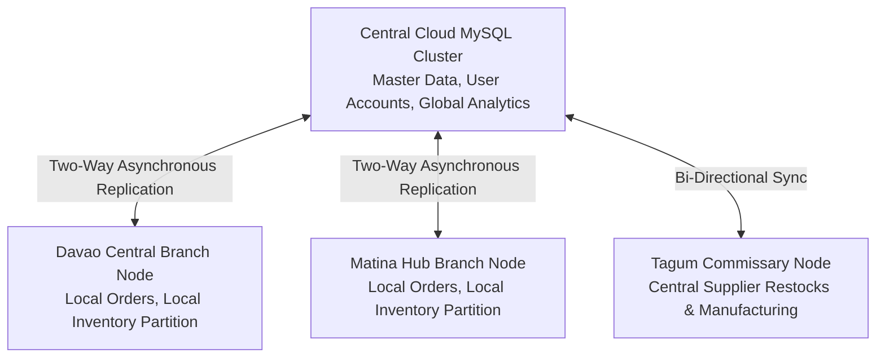
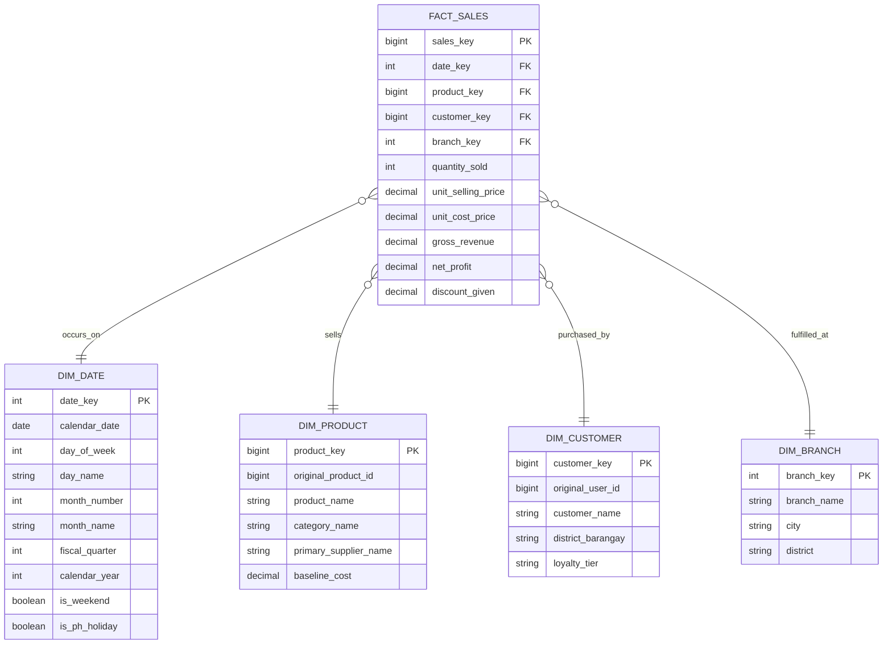

# ADDITIONAL DATABASE CONCEPTS & EXTENSIONS
## Database Systems 1 — Section G Design Proposals

**System:** Pastil Rice Davao: Inventory and Sales Management System  

---

### 1. Distributed Database Architecture for Multi-Location Expansion

#### Current Centralized Model
Currently, the Pastil Rice Davao database operates as a single MySQL instance handling ordering, customer profiles, and stock management for the primary Poblacion kitchen hub.

#### Proposed Distributed Extension (Multi-Branch Operation)
As Pastil Rice Davao scales across multiple Mindanao locations (e.g., Davao Central, Matina Branch, Buhangin Hub, and Tagum City Commissary), the system can be partitioned using a hybrid distributed database architecture:



1. **Horizontal Partitioning (Sharding by Branch/Location ID):**
   - Tables such as `orders`, `order_items`, and `inventory_logs` will include a `branch_id`.
   - Local kitchen nodes process branch-specific transactions independently with low network latency. Even if the wide-area internet connection drops, local branch cashiers can continue taking orders offline.
2. **Global Replication & Master Data Sync:**
   - Global catalog tables (`products`, `categories`, `users`) are replicated from the central cloud database to local branch nodes using **Read-Replicas** and **Row-Based Asynchronous Replication**.
   - Price updates made at head office propagate automatically across all branches.
3. **Distributed Transactions & Two-Phase Commit (2PC):**
   - When an order requires cross-branch stock transfers (e.g. Matina transfers 50 kg of chicken kagikit to Poblacion), the system utilizes **Two-Phase Commit (2PC)** or a **Saga Orchestration Pattern** to ensure atomicity across disparate database servers.

---

### 2. XML vs. JSON for Data Exchange and Semi-Structured Storage

#### Analysis of XML in Modern Food Service Systems
1. **B2B Supplier Interchange (Invoices & Logistics):**
   - XML remains widely used in legacy supply-chain protocols (such as GS1 XML and EDI for large meat processors and cold storage distributors).
   - XML's schema validation capabilities (**XSD — XML Schema Definition**) ensure that incoming supplier restock shipments strictly adhere to contractual product specifications before database insertion.
2. **Semi-Structured Document Storage in MySQL:**
   - MySQL provides native XML functions (`ExtractValue()`, `UpdateXML()`), which can parse XML-formatted delivery manifests directly in stored procedures:
     ```sql
     -- Parsing incoming shipment XML
     SET @supplier_xml = '<delivery id="88"><item product_id="1" qty="100"/></delivery>';
     SELECT ExtractValue(@supplier_xml, '/delivery/item/@qty') AS incoming_qty;
     ```
3. **Comparative Evaluation (XML vs. JSON):**
   - **For Web & Mobile Client Communication:** JSON is significantly superior due to smaller payload size, native JavaScript parsing in React, and minimal parsing overhead.
   - **For Enterprise Compliance & Formal Document Archiving:** XML is advantageous where strict XML DTD/XSD validation and digital signing are mandated by tax authorities (e.g., electronic invoice filing with the Bureau of Internal Revenue / BIR).

---

### 3. Data Warehousing, Dimensional Modeling & ETL Strategy

To prevent analytical queries from degrading live transaction performance, operational data from the OLTP (Online Transaction Processing) database should be transformed into an OLAP (Online Analytical Processing) Star Schema Data Warehouse.

#### Proposed Star Schema (Dimensional Model)



#### Extract, Transform, Load (ETL) Pipeline
1. **Extract:** A nightly cron batch task extracts completed orders, line items, and inventory deductions from the production MySQL InnoDB database during off-peak hours (e.g. 2:00 AM).
2. **Transform:**
   - Denormalizes product, supplier, and category attributes into slowly changing dimensions (SCD Type 2).
   - Computes derived profit metrics: $\text{Gross Profit} = \text{Revenue} - (\text{Quantity} \times \text{Cost Price})$.
   - Maps timestamps to the `DIM_DATE` table for fast slice-and-dice queries (e.g. comparing weekend sales vs. weekday lunch sales).
3. **Load:** Appends records into the analytical data warehouse.
4. **Business Intelligence (BI) Applications:**
   - **Sales Trend Forecasting:** Predicts kagikit demand based on historical holiday seasons in Davao City (Araw ng Dabaw, Kadayawan Festival).
   - **Basket Analysis:** Discovers which drinks (e.g. Calamansi Cooler) are most frequently bundled with specific pastil meal variants.
   - **Supply Chain Lead-Time Optimization:** Identifies slow suppliers whose restocking lag threatens kitchen stockouts.
